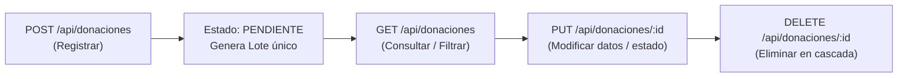

# 📘 Manual de Uso de API REST: Donaciones y Testimonios
### Plataforma Kallpa Solidary — Guía Práctica para Postman y Thunder Client

Este manual detalla paso a paso cómo consumir y probar las operaciones **GET**, **POST** *(push)*, **PUT** y **DELETE** en los módulos de **Donaciones** y **Testimonios**.

---

## ⚙️ 1. Configuración General

- **URL Base:** `http://localhost:8090` *(puerto por defecto configurado en `application.properties`)*.
- **Formato de datos:** `JSON` (`Content-Type: application/json`).
- **Autenticación y Seguridad:** 
  - Todos los endpoints bajo `/api/**` están configurados como **públicos** (`permitAll()`).
  - **CSRF:** Deshabilitado específicamente para `/api/**` para permitir pruebas libres sin requerir tokens de sesión en Postman o Thunder Client.
  - **CORS:** Habilitado para todos los orígenes (`*`) y métodos (`GET, POST, PUT, DELETE, etc.`), evitando bloqueos en extensiones o navegadores.
- **Importación rápida:** Puedes importar directamente el archivo [`postman_collection.json`](./postman_collection.json) en Postman o Thunder Client (en la sección *Collections > Import*).

---

## 🎁 2. Módulo de Donaciones (`/api/donaciones`)

Permite gestionar los bienes, víveres o aportes destinados a las campañas de ayuda.



---

### 2.1. GET — Listar Donaciones

#### A. Listar todas las donaciones registradas
- **Método:** `GET`
- **URL:** `http://localhost:8090/api/donaciones`
- **Headers:** *(Opcional)* `Accept: application/json`

**Ejemplo de Respuesta (`200 OK`):**
```json
[
  {
    "id": 1,
    "codigoLote": "LOTE-1001",
    "nombreDonante": "Supermercado MegaPerú",
    "producto": "Arroz",
    "cantidad": 150,
    "estado": "CONFIRMADO",
    "fechaIngreso": "2026-10-28T09:30:00",
    "campanaId": 1,
    "campanaTitulo": "Campaña de Alimentos",
    "campanaNombre": "Campaña de Alimentos",
    "campana": {
      "id": 1,
      "nombre": "Campaña de Alimentos",
      "descripcion": "Recolección de víveres",
      "meta": 1000
    }
  }
]
```

#### B. Filtrar donaciones mediante Query Params
Puedes combinar uno o varios parámetros en la URL:
- `?estado=PENDIENTE` (o `CONFIRMADO`, `RECHAZADO`)
- `?buscar=Arroz` (busca en donante, producto, lote o estado)
- `?campanaId=1`
- `?donante=MegaPerú`
- `?producto=Frazadas`

**Ejemplo:**
```http
GET http://localhost:8090/api/donaciones?estado=CONFIRMADO&buscar=Arroz
```

---

### 2.2. GET — Obtener Donación por ID

- **Método:** `GET`
- **URL:** `http://localhost:8090/api/donaciones/1`

**Respuesta Exitosa (`200 OK`):**
Retorna el objeto JSON de la donación encontrada.

**Respuesta si no existe (`404 Not Found`):**
```json
{
  "exito": false,
  "mensaje": "Donación no encontrada con id 999",
  "status": 404
}
```

---

### 2.3. POST (Push) — Registrar Donación

- **Método:** `POST`
- **URL:** `http://localhost:8090/api/donaciones`
- **Header obligatorio:** `Content-Type: application/json`

#### Campos y Alias admitidos:
El sistema es flexible y acepta múltiples nombres de campo para facilitar su prueba:
- `campanaId` *(o `campana_id`, `idCampana`, o el objeto `campana: { "id": 1 }`)*.
- `nombreDonante` *(o `donante`, `nombre`, `donor`, `usuario`)*.
- `producto` *(o `item`, `descripcion`, `articulo`, `bien`)*.
- `cantidad` *(o `monto`, `unidades`, `total`, `quantity`)*.
- `estado` *(o `status`)*: `PENDIENTE`, `CONFIRMADO` *(por defecto `PENDIENTE`)*.
- `codigoLote` *(opcional, se autogenera si se omite)*.

#### Ejemplo 1: Payload Completo (JSON)
```json
{
  "campanaId": 1,
  "nombreDonante": "Carlos Mendoza",
  "producto": "Frazadas térmicas polares",
  "cantidad": 20,
  "estado": "PENDIENTE"
}
```

#### Ejemplo 2: Payload Mínimo con Aliases (JSON)
```json
{
  "donante": "Lucía Ramírez",
  "bien": "Leche en polvo",
  "monto": 50
}
```
*(Asigna automáticamente la primera campaña activa, estado `PENDIENTE` y código de lote único).*

**Respuesta (`201 Created`):**
```json
{
  "exito": true,
  "mensaje": "Donación y lote registrados correctamente",
  "data": {
    "id": 8,
    "codigoLote": "LOTE-542110-B7F2",
    "nombreDonante": "Carlos Mendoza",
    "producto": "Frazadas térmicas polares",
    "cantidad": 20,
    "estado": "PENDIENTE",
    "fechaIngreso": "2026-10-28T10:15:30",
    "campanaId": 1,
    "campanaTitulo": "Campaña General de Ayuda",
    "campanaNombre": "Campaña General de Ayuda"
  }
}
```

> [!TIP]
> **Soporte Form Data:** Si en Postman o Thunder Client seleccionas `x-www-form-urlencoded` o `form-data` en lugar de `raw JSON`, el endpoint también procesa los campos correctamente sin arrojar error 415.

---

### 2.4. PUT — Actualizar Donación por ID

Permite modificar los datos de una donación existente. Puedes enviar actualización completa o únicamente los campos que deseas cambiar (actualización parcial).

- **Método:** `PUT`
- **URL:** `http://localhost:8090/api/donaciones/1`
- **Header:** `Content-Type: application/json`

#### Ejemplo de Body (Actualización parcial):
```json
{
  "producto": "Frazadas térmicas extra gruesas (Actualizado)",
  "cantidad": 35,
  "estado": "CONFIRMADO"
}
```

**Respuesta (`200 OK`):**
```json
{
  "exito": true,
  "mensaje": "Donación con ID 1 actualizada correctamente",
  "data": {
    "id": 1,
    "codigoLote": "LOTE-1001",
    "nombreDonante": "Supermercado MegaPerú",
    "producto": "Frazadas térmicas extra gruesas (Actualizado)",
    "cantidad": 35,
    "estado": "CONFIRMADO",
    "fechaIngreso": "2026-10-28T09:30:00",
    "campanaId": 1,
    "campanaTitulo": "Campaña de Alimentos"
  }
}
```

---

### 2.5. DELETE — Eliminar Donación por ID

Elimina la donación especificada y limpia automáticamente cualquier registro dependiente en la tabla de recepciones para evitar conflictos de integridad foránea.

- **Método:** `DELETE`
- **URL:** `http://localhost:8090/api/donaciones/1`

**Respuesta (`200 OK`):**
```json
{
  "exito": true,
  "mensaje": "Donación con ID 1 eliminada correctamente",
  "id": 1
}
```

---

## 💬 3. Módulo de Testimonios (`/api/testimonios`)

Permite gestionar los testimonios y opiniones que se muestran en la página principal.

---

### 3.1. GET — Listar Testimonios

#### A. Listar todos
- **Método:** `GET`
- **URL:** `http://localhost:8090/api/testimonios`

**Respuesta (`200 OK`):**
```json
[
  {
    "id": 1,
    "nombre": "Ana Ramos",
    "rol": "Donante",
    "comentario": "Me conmovió ver cómo la ayuda llega directamente a las familias.",
    "fechaCreacion": "2026-10-28T10:00:00"
  },
  {
    "id": 2,
    "nombre": "Jorge Silva",
    "rol": "Voluntario",
    "comentario": "Ser voluntario en Kallpa Solidary me enseñó el valor de la unión.",
    "fechaCreacion": "2026-10-28T10:05:00"
  }
]
```

#### B. Filtrar con Query Params
- `?rol=Donante` *(o `?rol=Voluntario`)*
- `?buscar=ayuda`
- `?nombre=Ana`

**Ejemplo:**
```http
GET http://localhost:8090/api/testimonios?rol=Donante&buscar=familias
```

---

### 3.2. GET — Obtener Testimonio por ID

- **Método:** `GET`
- **URL:** `http://localhost:8090/api/testimonios/1`

**Respuesta (`200 OK`):**
Retorna el testimonio individual solicitado. Si no existe, devuelve HTTP `404 Not Found`.

---

### 3.3. POST (Push) — Registrar Testimonio

- **Método:** `POST`
- **URL:** `http://localhost:8090/api/testimonios`
- **Header obligatorio:** `Content-Type: application/json`

#### Campos y Alias admitidos:
- `nombre` *(o `autor`, `usuario`, `name`)*.
- `rol` *(o `cargo`, `ocupacion`, `role`)*: ej. `Donante`, `Voluntario`, `Beneficiario`.
- `comentario` *(o `mensaje`, `contenido`, `opinion`, `comment`)*.

#### Ejemplo de Body (JSON):
```json
{
  "nombre": "Mariana Gómez",
  "rol": "Donante",
  "comentario": "Una experiencia hermosa poder colaborar con Kallpa Solidary. Toda la ayuda llega con transparencia."
}
```

**Respuesta (`201 Created`):**
```json
{
  "exito": true,
  "mensaje": "Testimonio registrado correctamente",
  "data": {
    "id": 3,
    "nombre": "Mariana Gómez",
    "rol": "Donante",
    "comentario": "Una experiencia hermosa poder colaborar con Kallpa Solidary. Toda la ayuda llega con transparencia.",
    "fechaCreacion": "2026-10-28T10:20:15"
  }
}
```

---

### 3.4. PUT — Actualizar Testimonio por ID

Permite modificar el nombre, rol o comentario de un testimonio existente.

- **Método:** `PUT`
- **URL:** `http://localhost:8090/api/testimonios/1`
- **Header:** `Content-Type: application/json`

#### Ejemplo de Body (JSON):
```json
{
  "nombre": "Ana Ramos de Córdova",
  "rol": "Voluntario",
  "comentario": "Comentario actualizado: Gran labor social de todo el equipo de voluntarios."
}
```

**Respuesta (`200 OK`):**
```json
{
  "exito": true,
  "mensaje": "Testimonio con ID 1 actualizado correctamente",
  "data": {
    "id": 1,
    "nombre": "Ana Ramos de Córdova",
    "rol": "Voluntario",
    "comentario": "Comentario actualizado: Gran labor social de todo el equipo de voluntarios.",
    "fechaCreacion": "2026-10-28T10:00:00"
  }
}
```

---

### 3.5. DELETE — Eliminar Testimonio por ID

- **Método:** `DELETE`
- **URL:** `http://localhost:8090/api/testimonios/1`

**Respuesta (`200 OK`):**
```json
{
  "exito": true,
  "mensaje": "Testimonio con ID 1 eliminado correctamente",
  "id": 1
}
```

---

## 📦 4. Módulo de Recepción de Donaciones (`/api/recepcion-donaciones`)

Cuando registras una donación, automáticamente se crea un registro de seguimiento en recepción:

| Método | Endpoint | Descripción | Body (JSON) |
|---|---|---|---|
| **GET** | `/api/recepcion-donaciones` | Listar todas las solicitudes | *(Vacío)* |
| **GET** | `/api/recepcion-donaciones/pendientes` | Listar solo pendientes | *(Vacío)* |
| **POST** | `/api/recepcion-donaciones/{id}/confirmar` | Pasa estado a `CONFIRMADO` | *(Vacío)* |
| **POST** | `/api/recepcion-donaciones/{id}/rechazar` | Pasa estado a `RECHAZADO` | `{"motivo": "Bienes en mal estado"}` |

---

## 🛠️ 5. Guía de Uso en Postman y Thunder Client

### A. En Thunder Client (Extensión de VS Code)
1. Instala la extensión **Thunder Client** desde el Marketplace de VS Code.
2. Abre la pestaña de Thunder Client en la barra lateral izquierda.
3. Haz clic en **Collections** > Icono de menú (tres puntos) > **Import**.
4. Selecciona el archivo `postman_collection.json` ubicado en la raíz del proyecto.
5. Haz clic en cualquier petición de la lista (ej. `4. POST - Registrar donación`) y presiona el botón **Send**.

### B. En Postman
1. Abre Postman.
2. Haz clic en el botón superior **Import**.
3. Arrastra o selecciona `postman_collection.json`.
4. En el panel izquierdo verás la colección **"Kallpa Solidary - Donaciones y Testimonios"**.
5. Para probar peticiones con cuerpo:
   - Ve a la pestaña **Headers** y verifica `Content-Type: application/json`.
   - Ve a la pestaña **Body**, selecciona **raw** y formato **JSON**.
   - Haz clic en **Send**.

---

## 🚦 6. Resumen de Códigos HTTP y Diagnóstico

| Código | Significado | Causa común |
| :---: | :--- | :--- |
| **`200 OK`** | Operación exitosa | GET, PUT o DELETE completado con éxito. |
| **`201 Created`** | Recurso creado | POST ejecutado correctamente. Se incluye el objeto creado en `data`. |
| **`400 Bad Request`** | Solicitud incorrecta | JSON con sintaxis rota o datos no válidos. El servidor responde con detalles en `mensaje` o `errores`. |
| **`404 Not Found`** | No encontrado | El ID solicitado en la URL no existe en la base de datos. |
| **`405 Method Not Allowed`**| Método no permitido | Por ejemplo, enviar un `PATCH` donde solo se admite `PUT` o `POST`. |
| **`500 Internal Error`** | Error del servidor | Error no controlado (verificar logs en consola). |

---

> [!NOTE]
> Este manual documenta la versión de la API actualizada con soporte para **CORS libre**, **desactivación de CSRF para API**, **alias dinámicos en requests** y **respuestas JSON estructuradas**.
